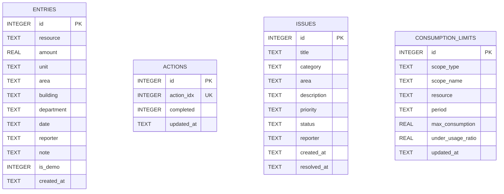

# 🌿 EcoCampus – Smart Campus Sustainability Platform

> An intelligent, full-stack campus sustainability platform that tracks utility consumption, crowdsources environmental incident reports, gamifies inter-departmental conservation, simulates IoT telemetry through an administrator-only dashboard, and delivers algorithmic eco-advisory insights to minimize institutional carbon footprints.

[](https://www.python.org/)
[](https://flask.palletsprojects.com/)
[-003B57?style=flat&logo=sqlite&logoColor=white)](https://www.sqlite.org/)
[](LICENSE)
[-15803d?style=flat&logo=checkmarx&logoColor=white)](#10-testing-and-troubleshooting)
[](#12-deployment)

---

## 📋 Table of Contents

1. [Project Overview](#1-project-overview)
2. [Key Features](#2-key-features)
3. [Technology Stack](#3-technology-stack)
4. [Project Architecture](#4-project-architecture)
5. [Project Folder Structure](#5-project-folder-structure)
6. [Installation and Setup](#6-installation-and-setup)
7. [REST API Documentation](#7-rest-api-documentation)
8. [Database Design](#8-database-design)
9. [Business Logic & Mathematical Models](#9-business-logic--mathematical-models)
10. [Testing and Troubleshooting](#10-testing-and-troubleshooting)
11. [Security and Configuration](#11-security-and-configuration)
12. [Production Deployment](#12-production-deployment)
13. [Future Roadmap](#13-future-roadmap)
14. [Interactive Demo Flow](#14-interactive-demo-flow)
15. [Senior Engineer Technical Analysis](#15-senior-engineer-technical-analysis)

---

## 1. Project Overview

### Problem Statement
Educational institutions, university colleges, and corporate campuses consume massive amounts of electrical power, potable water, paper stationery, and generate significant food and plastic waste. However, sustainability initiatives at modern institutions suffer from:
- **Siloed Utility Data:** Utility bills are audited weeks after billing cycles, making real-time leak detection impossible.
- **Unreported Facilities Wastage:** Running bathroom taps, unmonitored air conditioning units in vacant auditoriums, and overflowing recycling bins go unaddressed due to lack of a direct reporting mechanism.
- **Lack of Stakeholder Engagement:** Students, faculty members, and staff lack visibility into their departmental footprint and have zero incentive to participate in resource conservation.
- **Absence of Actionable Analytics:** Administration lacks unified data for regulatory sustainability compliance audits (e.g., NAAC, NIRF, ISO 14001).

### Proposed Solution
**EcoCampus** is a centralized, lightweight, and deployment-ready sustainability platform designed to bridge the gap between facilities management and campus occupants. It offers:
1. **Centralized Utility Ledger:** Manual sub-meter logging and administrator-triggered IoT telemetry simulation for electricity, water, paper, and waste.
2. **Crowdsourced Maintenance Ticketing:** Student and staff reporting desk to track facilities leaks and equipment idle-run from report to resolution.
3. **Gamified Inter-Faculty Competition:** Dynamic leaderboards ranking faculties, departments, and residential hostels with verified eco-points.
4. **Algorithmic AI Eco-Advisor:** Real-time heuristic consumption analysis detecting usage spikes, computing potential financial savings in Rupees (**₹**), and estimating avoided carbon dioxide emissions (**kg CO₂**).

---

## 2. Key Features

| Feature | Description | Implementation Status |
|---|---|---|
| **Resource Monitoring** | Building-, department-, and university-wide daily/weekly/monthly actuals, historical averages, configurable limits, status classification, trend charts, data-quality warnings, and actionable alerts. | ✅ Fully Implemented |
| **Incident Ticketing** | Crowdsourced leak & waste reporting with priority tags (`Low`, `Medium`, `High`) and lifecycle workflow (`Reported` ➔ `In Progress` ➔ `Resolved`). | ✅ Fully Implemented |
| **Department Leaderboard** | Dynamic semester ranking across 6 university departments & hostels based on utility efficiency, audits, and resolved tickets. | ✅ Fully Implemented |
| **AI Eco-Advisor** | Algorithmic heuristic analysis identifying consumption spikes, open hazard impacts, circular economy opportunities, and financial savings. | ✅ Fully Implemented *(Rule-based heuristic)* |
| **IoT Sensor Ingestion** | Administrator-only dashboard simulator (`POST /api/sensors/ingest`) protected by the signed-in session and CSRF token. | ✅ Fully Implemented |
| **Executive Reports & Export** | One-click printable PDF view (`@media print`) and RFC 4180 CSV export with formula injection sanitization. | ✅ Fully Implemented |
| **Green Habit Checklist** | Interactive daily checklist allowing campus users to commit to and track 5 core sustainable habits. | ✅ Fully Implemented |
| **Light & Dark Mode** | Dual-theme system with high-contrast accessibility (WCAG AA), glassmorphism visuals, and `localStorage` persistence. | ✅ Fully Implemented |

> [!NOTE]
> **AI/ML Clarification:** The current **AI Eco-Advisor** executes deterministic statistical threshold algorithms and heuristic business rules across live database aggregates. It does **not** make calls to external third-party Large Language Model APIs (e.g., OpenAI or Claude), ensuring 100% offline functionality, zero API latency, and zero cloud API billing costs.

---

## 3. Technology Stack

### Frontend
- **Markup & Structure:** Semantic HTML5 with accessible ARIA tags and unique element identifiers.
- **Styling & Design System:** Vanilla CSS3 using custom properties (CSS variables), CSS Grid, Flexbox, backdrop-filter glassmorphism, and responsive breakpoints (`960px`, `print`). Zero heavyweight CSS framework dependencies.
- **Client Logic:** Vanilla JavaScript (ES6+), asynchronous Fetch API, dynamic DOM manipulation, and browser `localStorage` state management.
- **Visualizations:** Pure CSS bar charts with interactive hover tooltips and dynamic CSS progress bars (zero external charting library overhead).

### Backend
- **Runtime:** Python 3.9+ (tested on Python 3.11).
- **Web Framework:** [Flask 3.1.1](https://flask.palletsprojects.com/) (micro-framework serving RESTful JSON endpoints and the unified single-page application).
- **CORS Handling:** [Flask-CORS 6.0.5](https://pypi.org/project/Flask-CORS/) with configurable origin restrictions.
- **Configuration Management:** [python-dotenv 1.1.0](https://pypi.org/project/python-dotenv/).

### Database Layer
- **Engine:** [SQLite 3](https://www.sqlite.org/) with Write-Ahead Logging (`PRAGMA journal_mode=WAL`) enabled for high-concurrency read/write throughput.
- **Data Integrity:** Foreign key enforcement (`PRAGMA foreign_keys=ON`) and thread concurrency handling (`PRAGMA busy_timeout=20000`).

### Production WSGI & Containerization
- **Windows Production Server:** [Waitress 3.0.2](https://pypi.org/project/waitress/) (multi-threaded, production-grade WSGI server).
- **Linux / Cloud WSGI:** [Gunicorn 23.0.0](https://gunicorn.org/) (Render should use one worker with four threads for SQLite startup).
- **Containerization:** Docker build on `python:3.11-slim` with unprivileged non-root execution (`appuser`) and container healthcheck probes.
- **PaaS Deployments:** Configured for [Render](https://render.com) (`render.yaml`) and [Railway](https://railway.app) (`Procfile`).

---

## 4. Project Architecture

EcoCampus follows a decoupled **Client-Server RESTful Architecture** where the Python Flask server serves both the static Single-Page Application (SPA) and exposes the data API endpoints.


---

## 5. Project Folder Structure

```text
ecocampus_mvp/
├── .dockerignore         # Specifies files excluded from Docker container builds
├── .env.example          # Environment variable template for production configuration
├── DEPLOYMENT.md         # Production deployment guide (Render, Railway, Docker, Windows)
├── Dockerfile            # Container build recipe based on python:3.11-slim with health check
├── Procfile              # Process execution definition for Render / Railway / Heroku
├── README.md             # Complete technical project documentation (this file)
├── README.txt            # Quick plain-text setup notes
├── audit_verifier.py     # Standalone 10-point test script for verifying database and endpoints
├── database.py           # SQLite connection pool, schema, CRUD operations & analytical engine
├── ecocampus.db          # Embedded SQLite database file with WAL journal files
├── index.html            # Unified Single-Page Application (HTML5, CSS3, Vanilla JS)
├── render.yaml           # Infrastructure-as-code blueprint for Render automated deployments
├── requirements.txt      # Pinned Python package dependencies
├── server.py             # Flask application, REST API routing, input validation & middleware
├── test_ecocampus.py     # Standard Python unittest comprehensive test suite
└── wsgi.py               # WSGI entry point for production servers (Gunicorn / Waitress)
```

---

## 6. Installation and Setup

### Prerequisites
- **Python 3.9+** installed on your system.
- **Git** (optional, for cloning the repository).
- Modern web browser (Chrome, Edge, Firefox, Safari).

### Step-by-Step Local Setup

#### 1. Navigate to Project Directory
```bash
cd ecocampus_mvp
```

#### 2. Create and Activate a Python Virtual Environment
- **On Windows (PowerShell):**
  ```powershell
  python -m venv venv
  .\venv\Scripts\Activate.ps1
  ```
- **On macOS / Linux:**
  ```bash
  python3 -m venv venv
  source venv/bin/activate
  ```

#### 3. Install Required Dependencies
```bash
pip install -r requirements.txt
```

#### 4. Configure Environment Variables
Copy `.env.example` to `.env` to customize default parameters:
```bash
# Windows
copy .env.example .env

# Linux / macOS
cp .env.example .env
```
Set `BOOTSTRAP_ADMIN_USERNAME` and `BOOTSTRAP_ADMIN_PASSWORD` in `.env` before starting the server to create the first administrator (password must be 1-8 characters). This short password limit is less secure; use it only on a trusted/private deployment. Keep these values server-side and do not commit `.env`. Users can create standard accounts from the sign-in page; administrators assign department managers from **Users & Roles**. If an administrator is not configured, registration still creates standard user accounts but no account can perform admin actions.

#### 5. Verify Database Initialization & Run Automated Tests
EcoCampus initializes all database tables, constraints, indexes, and initial demo records automatically upon server startup. You can also run the built-in test suite:
```bash
python audit_verifier.py
```
*(All 10 verification checkpoints must output `[PASS]`)*

#### 6. Start the Application Server
```bash
python server.py
```
*Console output:*
```text
2026-10-12 [INFO] ecocampus: Database initialized successfully with all tables and indexes.
2026-10-12 [INFO] ecocampus: 🌿 Starting EcoCampus server on http://0.0.0.0:5501 (debug=False)
```

#### 7. Open the Application
Launch your web browser and open:
👉 **`http://localhost:5501`**

> [!IMPORTANT]
> **Single Unified Server:** You do **not** need to run a separate terminal for the frontend. The Flask backend serves `index.html` directly from the root path (`/`).

---

## 6.1 Accounts, Panels, and Permissions

Open `/login` to sign in or create a standard user account. Use **Sign out** in the panel sidebar to clear the session and return to the login form. New account passwords must contain 1-8 characters; existing accounts with longer passwords can still sign in. Registration never accepts a role or department; new accounts always start as `user`. Configure `BOOTSTRAP_ADMIN_USERNAME` and a 1-8 character `BOOTSTRAP_ADMIN_PASSWORD` in the server environment to create the first administrator. Admins can promote accounts to department manager and assign the department in **Users & Roles**.

| Capability | Administrator | Department manager | User |
|---|---|---|---|
| Campus-wide dashboard, monitoring, limits | View all; configure limits | Assigned-department monitoring only | Approved campus aggregate; no building/department detail |
| Resource records | View/manage all | View/manage assigned-department records | View own records; submit own readings |
| Incidents | View/update/delete all | View/update assigned-department incidents | Submit and view own incidents |
| Leaderboard and eco-advisor | University-wide | Assigned department / department-owned insights | Public leaderboard and own-record insights |
| Accounts, roles, audit log, exports | Manage, review, export | No access | No access |
| Green Actions | Own participation | Own participation | Own participation |

API role checks are server-side; the signed session stores only the account ID, and the role is reloaded from SQLite on every request. Passwords are stored as one-way hashes. Mutating requests require a session-bound CSRF token. SQLite startup migrations add account ownership to new entries/incidents while preserving existing records; legacy rows without an owner remain administrator/manager data and are not shown as a user's own records. Administrative changes to limits, incidents, and accounts are audit logged.

Routes `/user/dashboard`, `/user/leaderboard`, `/user/incidents`, `/user/eco-advisor`, `/user/resources`, `/user/activities`, `/user/green-actions`, `/admin/dashboard`, `/admin/consumption`, `/admin/users`, and `/admin/audit-logs` open the role-appropriate panel sections. The backend rejects unauthorized admin page and API access even if a user edits the URL or page JavaScript.

---

## 7. REST API Documentation

All endpoints return JSON responses unless otherwise noted. Except health and authentication bootstrap endpoints, API routes require a signed-in session. Mutating requests require the `X-CSRF-Token` returned by `/api/auth/me`; administrative routes require the server-verified `admin` role.

| Method | Endpoint | Description | Request Body / Parameters | Success Status |
|---|---|---|---|:---:|
| `GET` | `/health` | Liveness health check | None | `200 OK` |
| `GET` | `/api/auth/me` | Current account and CSRF token | Session cookie | `200 OK` |
| `POST` | `/api/auth/register` | Register a standard user account | JSON; `X-CSRF-Token` header | `201 Created` |
| `POST` | `/api/auth/login` | Sign in | JSON; `X-CSRF-Token` header | `200 OK` |
| `POST` | `/api/auth/logout` | Sign out | Session cookie; `X-CSRF-Token` header | `200 OK` |
| `GET` | `/api/entries` | List records visible to the account's role | Session cookie | `200 OK` |
| `POST` | `/api/entries` | Log a manual utility reading | JSON object (resource, amount, unit, area, date; optional building, department) | `201 Created` |
| `DELETE` | `/api/entries/<id>` | Delete a resource entry by ID | None (URL path integer parameter) | `200 OK` |
| `GET` | `/api/totals` | Get aggregated sums per resource | None | `200 OK` |
| `GET` | `/api/monitoring?period=daily&resource=electricity` | Building, department, and university monitoring analysis; period is `daily`, `weekly`, or `monthly`, resource is supported type or `all` | Query parameters | `200 OK` |
| `GET` | `/api/monitoring/limits` | List saved administrator limits and whether updates are enabled | None | `200 OK` |
| `POST` | `/api/monitoring/limits` | Create/update a resource limit for a building, department, or university | Admin session; JSON; `X-CSRF-Token` header | `200 OK` |
| `GET` | `/api/admin/users` | List accounts and role assignments | Admin session | `200 OK` |
| `PATCH` | `/api/admin/users/<id>` | Assign a role/department or disable an account | Admin session; JSON; `X-CSRF-Token` header | `200 OK` |
| `GET` | `/api/admin/audit-logs` | List recent privileged changes | Admin session | `200 OK` |
| `GET` | `/api/actions` | Get completed green action indices | None | `200 OK` |
| `POST` | `/api/actions` | Toggle a checklist action | `{"action_idx": int, "completed": bool}` | `200 OK` |
| `GET` | `/api/issues` | List all reported facilities tickets | None | `200 OK` |
| `POST` | `/api/issues` | Report a leak or hazard ticket | JSON object (title, category, area, priority, desc) | `201 Created` |
| `POST` | `/api/issues/<id>/status` | Update issue lifecycle status | `{"status": "In Progress" \| "Resolved"}` | `200 OK` |
| `DELETE` | `/api/issues/<id>` | Remove an issue ticket by ID | None (URL path integer parameter) | `200 OK` |
| `GET` | `/api/leaderboard` | Get department rankings & points | None | `200 OK` |
| `GET` | `/api/insights` | Get AI advisor alerts & savings | None | `200 OK` |
| `POST` | `/api/sensors/ingest` | Ingest telemetry from the administrator dashboard simulator | Admin session; JSON; `X-CSRF-Token` header | `201 Created` |
| `GET` | `/api/export` | Download records as RFC 4180 CSV | None (Returns CSV file attachment) | `200 OK` |

### Representative Request & Response Payloads

#### 1. Ingest Simulated Sensor Reading (`POST /api/sensors/ingest`)
**Request:**
```http
POST /api/sensors/ingest HTTP/1.1
Host: localhost:5501
Content-Type: application/json
Cookie: <administrator session>
X-CSRF-Token: <session CSRF token>

{
  "resource": "electricity",
  "amount": 18.5,
  "unit": "kWh",
  "area": "Computer Lab 3",
  "sensor_id": "ESP32-PWR-04"
}
```
**Response (`201 Created`):**
```json
{
  "ok": true,
  "message": "Telemetry reading ingested.",
  "entry": {
    "id": 14,
    "resource": "electricity",
    "amount": 18.5,
    "unit": "kWh",
    "area": "Computer Lab 3",
    "date": "2026-10-12",
    "reporter": "IoT Meter (ESP32-PWR-04)",
    "note": "Automated reading received via /api/sensors/ingest",
    "is_demo": 0,
    "created_at": "2026-10-12 11:45:00"
  }
}
```

#### 2. Get Department Leaderboard (`GET /api/leaderboard`)
**Response (`200 OK`):**
```json
[
  {
    "rank": 1,
    "department": "Computer Science & IT",
    "code": "CS",
    "building": "Tech Tower",
    "points": 995,
    "base_score": 920,
    "co2_saved_kg": 179.1,
    "efficiency": "96%",
    "badge": "Eco Champion 🥇"
  },
  {
    "rank": 2,
    "department": "Mechanical Engineering",
    "code": "ME",
    "building": "West Wing",
    "points": 915,
    "base_score": 840,
    "co2_saved_kg": 164.7,
    "efficiency": "91%",
    "badge": "Energy Guardian 🥈"
  }
]
```

#### 3. Update Incident Lifecycle (`POST /api/issues/1/status`)
**Request:**
```json
{
  "status": "Resolved"
}
```
**Response (`200 OK`):**
```json
{
  "ok": true,
  "message": "Issue status updated to Resolved."
}
```

---

## 8. Database Design

EcoCampus utilizes SQLite 3 configured in Write-Ahead Logging mode (`WAL`).



### Table Specifications

#### 1. `entries` Table
Stores all manual meter readings and automated IoT telemetry records.
- `id` (INTEGER, Primary Key, Auto-increment)
- `resource` (TEXT, NOT NULL) — Must be one of: `electricity`, `water`, `paper`, `waste`, `generalWaste`.
- `amount` (REAL, NOT NULL) — Enforced by table constraint: `CHECK(amount >= 0)`; a zero reading is valid.
- `unit` (TEXT, NOT NULL) — e.g., `kWh`, `L`, `sheets`, `kg`.
- `area` (TEXT, NOT NULL) — Meter/room location.
- `building` (TEXT, NOT NULL) — Building used for building totals. Existing records and omitted values fall back to `area`.
- `department` (TEXT, NOT NULL) — Department attribution; defaults to `Unassigned`.
- `date` (TEXT, NOT NULL) — ISO 8601 date string (`YYYY-MM-DD`).
- `reporter` (TEXT, DEFAULT `''`) — Name, student ID, or sensor identifier.
- `note` (TEXT, DEFAULT `''`) — Contextual reading description.
- `is_demo` (INTEGER, DEFAULT 0) — Boolean flag distinguishing seed demo records from production readings.
- `created_at` (TEXT, DEFAULT `datetime('now')`) — Creation timestamp.
- **Indexes:** `idx_entries_resource ON entries(resource)`, `idx_entries_date ON entries(date)`.

#### 4. `consumption_limits` Table
One administrator-managed limit per scope, resource, and analysis period. Updating an existing key replaces its limit and under-usage threshold.
- `scope_type`: `building`, `department`, or `university`.
- `scope_name`: Exact building/department name; the university scope uses `University`.
- `resource`: `electricity`, `water`, `paper`, `waste`, or `generalWaste`.
- `period`: `daily`, `weekly`, or `monthly`.
- `max_consumption`: Positive upper limit in the reading unit.
- `under_usage_ratio`: Configurable fraction from `0` through `1` of historical average below which usage is flagged as unusually low.

#### 2. `actions` Table
Stores completion states for campus community green habits.
- `id` (INTEGER, Primary Key, Auto-increment)
- `action_idx` (INTEGER, NOT NULL, UNIQUE) — Action index between 0 and 4.
- `completed` (INTEGER, DEFAULT 1) — 1 = checked, 0 = unchecked.
- `updated_at` (TEXT, DEFAULT `datetime('now')`) — Last update timestamp.

#### 3. `issues` Table
Maintains crowdsourced environmental incident reports and maintenance tickets.
- `id` (INTEGER, Primary Key, Auto-increment)
- `title` (TEXT, NOT NULL) — Concise incident title.
- `category` (TEXT, NOT NULL) — `water`, `electricity`, `waste`, or `other`.
- `area` (TEXT, NOT NULL) — Specific campus location of the hazard.
- `description` (TEXT, DEFAULT `''`) — Detailed explanation.
- `priority` (TEXT, DEFAULT `'Medium'`) — `Low`, `Medium`, or `High`.
- `status` (TEXT, DEFAULT `'Reported'`) — `Reported`, `In Progress`, or `Resolved`.
- `reporter` (TEXT, DEFAULT `'Student Volunteer'`) — Name or team logging the ticket.
- `created_at` (TEXT, DEFAULT `datetime('now')`) — Ticket creation timestamp.
- `resolved_at` (TEXT) — Timestamp automatically populated when ticket transitions to `Resolved`.
- **Indexes:** `idx_issues_status ON issues(status)`.

---

## 9. Business Logic & Mathematical Models

### Resource Monitoring Formulas and Configuration
- **Period buckets:** Daily readings group by calendar date; weekly readings group by ISO week; monthly readings group by calendar month. The dashboard uses the latest available bucket for actual consumption and plots up to 12 bucket totals.
- **Building/department average:** Arithmetic mean of the recorded period totals for that scope (periods without a reading are not silently treated as zero). A real zero reading is retained and included.
- **Unit normalization:** Monitoring converts recognized units to kWh, L, sheets, or kg before grouping (for example, kL and m³ to L, Wh to kWh, and g to kg). Unsupported historical units are excluded and counted in the data-quality warning; new API readings with incompatible resource units are rejected.
- **University actual:** Sum of all building readings for the same resource and latest period. Department subtotals are a separate view of those entries and are not added to the university total.
- **University average:** Arithmetic mean of university totals over the observed period buckets. `average_per_building` is the arithmetic mean of each building's period average; `average_per_building_current_period` is the latest university actual divided by buildings with a reading in that period.
- **Daily average:** `average_daily_consumption` is independently computed from university totals on dates with at least one reading, including when the selected view is weekly or monthly. The dashboard displays this separately from the selected-period average and per-building average.
- **Fair comparisons:** The existing ledger has no floor-area, occupancy, or operating-hours metadata, so values are compared in absolute canonical units rather than inventing normalized metrics. The dashboard explicitly indicates this limitation.
- **Effective maximum:** Administrator limit when configured; otherwise the scope's historical average multiplied by `MONITORING_LIMIT_MULTIPLIER` (default `1.5`). University default limits sum the effective building limits to keep the aggregate consistent. If no useful history exists, optional `MONITORING_BASELINE_LIMITS` can provide sample-data limits by resource; the dashboard labels these as configured baselines.
- **Status precedence:** Actual greater than maximum is **Over Consumption**; otherwise actual below `average × under_usage_ratio` is **Under Usage**; otherwise **Within Limit**. Missing latest-period readings, no usable baseline/limit, and outdated readings are explicitly surfaced as data-quality states instead of being mislabeled as under usage. The default under-usage ratio is `0.5`; administrators may override it for each saved limit.
- **Alerts:** Current alerts are generated once per scope/resource/period/status and include a recommendation. Under-usage advice asks staff to verify occupancy and meter connectivity; it is not automatically treated as an efficiency win.

Limit updates require an authenticated administrator session and a CSRF token. Roles are loaded from the account database on every request; a frontend-supplied role does not grant administrator permissions. The administrator's request body is:

```json
{
  "scope_type": "building",
  "scope_name": "Tech Tower",
  "resource": "electricity",
  "period": "daily",
  "max_consumption": 400,
  "under_usage_ratio": 0.5
}
```

The optional `MONITORING_BASELINE_LIMITS` environment variable accepts a JSON object such as `{"electricity":400,"water":2000}`. Limits use the unit stored with that resource (for example, kWh, L, sheets, or kg). `MONITORING_UNDER_USAGE_RATIO` sets the default under-usage fraction for scopes without a saved override.

### 1. Departmental Leaderboard Scoring Algorithm
Rankings are computed dynamically in [`database.py`](./database.py) using the verified formula:

$$\text{Points} = \text{Base Score} + (\text{Completed Actions} \times 15) + (\text{Resolved Tickets} \times 20) + (\text{Total Audits} \times 5)$$

Where:
- $\text{Base Score}$: Institutional baseline allocated per department (CS: 920, ME: 840, CE: 810, EC: 775, MBA: 730, Hostels: 690).
- $\text{Completed Actions}$: Count of distinct active daily green habits.
- $\text{Resolved Tickets}$: Count of campus hazards addressed by facilities maintenance.
- $\text{Total Audits}$: Volume of logged utility meter entries.

#### Departmental Carbon Offset Model
$$\text{CO}_2 \text{ Avoided (kg)} = \text{Points} \times 0.18$$

#### Dynamic Efficiency Rating
$$\text{Efficiency \%} = \max\left(60,\, \min(99,\, 96 - (\text{Rank} - 1) \times 5)\right)$$

### 2. Issue Lifecycle State Machine
```text
[Reported] ──(Facilities Dispatched)──> [In Progress] ──(Work Completed)──> [Resolved]
                                                                                │
                                                                   (Sets resolved_at UTC)
```
Tickets cannot transition to arbitrary states; invalid status mutations are rejected with HTTP 400.

### 3. AI Eco-Advisor Heuristic Rules
The AI Advisor evaluates utility totals and issue counts across four algorithmic checkpoints:
1. **Electricity Anomaly Spike:** If total electricity $> 100 \text{ kWh}$, queries the highest consuming campus area and generates a **Warning** insight with an estimated monthly savings of ₹3,400 and $-18.5\text{ kg CO}_2$.
2. **Water Conservation Opportunity:** If total water $> 500 \text{ L}$, generates an **Info** recommendation for tap flow aerators estimating $-35\%$ flow reduction and ₹1,850 financial recovery.
3. **Hazard Backlog Penalty:** If open issues $> 0$, generates an **Alert** prompting facilities attention to stop compounding resource loss.
4. **Circular Economy Recovery:** Evaluates segregated organic waste and calculates potential compost yields in kilograms.

---

## 10. Testing and Troubleshooting

### Running the Test Suites

#### 1. Standalone Verification Audit (Fast)
```bash
python audit_verifier.py
```
Checks database schema creation, CRUD operations, health endpoints, IoT ingestion, CSV sanitization, and leaderboard scoring.

#### 2. Comprehensive Unittest Suite
```bash
python -m unittest test_ecocampus.py -v
```
Runs the comprehensive integration tests using an isolated temporary SQLite database, including monitoring arithmetic, threshold transitions, zero/missing/stale readings, period grouping, account roles, CSRF, and authorization.

### Common Troubleshooting Scenarios

| Issue | Cause | Solution |
|---|---|---|
| `Address already in use (Port 5501)` | Another process is occupying port 5501. | Change port in `.env` (`PORT=5502`) or terminate the existing process: <br>• Windows: `netstat -ano \| findstr :5501` then `taskkill /PID <PID> /F`<br>• Linux: `lsof -i :5501` then `kill -9 <PID>` |
| `sqlite3.OperationalError: database is locked` | SQLite file locked by external tool. | EcoCampus uses `PRAGMA busy_timeout=20000` and WAL mode. Ensure you do not leave an external SQLite browser open in write transaction mode. |
| `ModuleNotFoundError: No module named 'flask'` | Virtual environment not active. | Activate your virtual environment (`.\venv\Scripts\Activate.ps1` or `source venv/bin/activate`) before running `python server.py`. |
| `CORS Error in Browser Console` | Frontend accessed from an unauthorized domain. | In `.env`, set `CORS_ORIGINS=*` or add your specific origin (e.g. `https://mycampus.edu`). |

---

## 11. Security and Configuration

### Configuration Environment Variables

| Variable | Default Value | Description |
|---|---|---|
| `PORT` | `5501` | TCP port on which the Flask server listens |
| `HOST` | `0.0.0.0` | Network binding interface (`0.0.0.0` binds to all interfaces) |
| `FLASK_DEBUG` | `0` | Set `0` for production; `1` for local development |
| `DATABASE_PATH` | `ecocampus.db` | Absolute or relative path to the SQLite database file |
| `CORS_ORIGINS` | `*` | Allowed CORS origins for external API clients |
| `BOOTSTRAP_ADMIN_USERNAME` | unset | Username for the first administrator account |
| `BOOTSTRAP_ADMIN_PASSWORD` | unset | Server-side bootstrap password; 1-8 characters (weak; avoid public deployment) |
| `SESSION_SECRET_KEY` | DB-generated | Stable session-signing secret; configure explicitly for multi-instance deployments |
| `SESSION_COOKIE_SECURE` | `0` | Set to `1` when serving over HTTPS |
| `MONITORING_LIMIT_MULTIPLIER` | `1.5` | Derived maximum as a multiple of the historical average; must be greater than 0 and at most 10 |
| `MONITORING_UNDER_USAGE_RATIO` | `0.5` | Default low-usage threshold as a fraction of historical average (`0` to `1`) |
| `MONITORING_BASELINE_LIMITS` | `{}` | Optional JSON object of per-resource fallback limits when history is unavailable |

### Security Hardening Measures
1. **OWASP / CWE-1236 Formula Injection Sanitization:**
   In [`server.py`](./server.py), all text exported to CSV is evaluated through `sanitize_csv_cell()`. If an entry string begins with spreadsheet formula operators (`=`, `+`, `-`, `@`, `\t`, `\r`), a leading single quote (`'`) is prepended to neutralize formula execution in Microsoft Excel and LibreOffice Calc.
2. **Security HTTP Response Headers:**
   Every HTTP response applies:
   - `X-Content-Type-Options: nosniff`
   - `X-Frame-Options: SAMEORIGIN`
   - `X-XSS-Protection: 1; mode=block`
   - `Referrer-Policy: strict-origin-when-cross-origin`
3. **Strict Input Boundary Validation:**
   - Numerical amounts must be non-negative, finite numbers (`math.isnan` and `math.isinf` rejections).
   - Numerical cap enforced at `10,000,000` to prevent database integer/float overflow attacks.
   - Text fields are truncated (`reporter[:80]`, `note[:200]`, `description[:300]`) to protect against storage bloat and payload denial-of-service.

---

## 12. Production Deployment

### Option 1: Docker (Recommended for Containers)

```bash
# 1. Build the Docker container image
docker build -t ecocampus:latest .

# 2. Run container mapping host port 5501 to container port 5501
docker run -d -p 5501:5501 --name ecocampus-prod ecocampus:latest

# 3. (Optional) Run with a persistent database volume
docker run -d -p 5501:5501 -v ecocampus_data:/app ecocampus:latest
```

The Docker container runs with an unprivileged `appuser` (UID 1000) and includes an automatic Docker `HEALTHCHECK` probing `http://localhost:5501/health`.

### Option 2: Render Web Service Deployment
1. Push the project to GitHub. Do not commit `.env`; configure secrets in Render instead.
2. In [Render](https://dashboard.render.com/), choose **New + → Web Service**, connect GitHub, and select the repository.
3. Because the repository contains a `Dockerfile`, use the Docker runtime. For a repository-root deployment, set **Dockerfile Path** to `./Dockerfile` and **Docker Build Context Directory** to `.`. Leave Registry Credential and Pre-Deploy Command blank.
4. Set **Docker Command** to:
   ```text
   gunicorn wsgi:app --bind 0.0.0.0:$PORT --workers 1 --threads 4 --timeout 60
   ```
   A single worker avoids concurrent SQLite initialization collisions; the four threads still handle concurrent requests.
5. Add these service environment variables:

   | Key | Value |
   |---|---|
   | `BOOTSTRAP_ADMIN_USERNAME` | Administrator username, e.g. `admin` |
   | `BOOTSTRAP_ADMIN_PASSWORD` | Administrator password; current application limit is 1-8 characters (weak for a public service) |
   | `SESSION_SECRET_KEY` | Long random secret generated privately; keep it out of source control |
   | `SESSION_COOKIE_SECURE` | `1` |

   Render supplies `PORT`; do not set it manually. Do not upload `.env`. Auto-Deploy may remain enabled; Build Filters and Pre-Deploy Command can stay at their defaults/blank.
6. Create the service and wait for deployment. Check the service logs for Gunicorn startup, then visit `https://<service-name>.onrender.com/health`; the health endpoint should report `healthy`.
7. SQLite data on an ephemeral instance may be lost when Render replaces or restarts it. If the plan supports a persistent disk, attach it at `/var/data` and set `DATABASE_PATH=/var/data/ecocampus.db`. Keep SQLite on a single service instance; do not scale multiple instances against a local SQLite database.

If using **Blueprint** instead of Web Service, Render reads [`render.yaml`](./render.yaml). Review the command configured there and set the single-worker Docker/Gunicorn command above in the service settings when applicable.

### Option 3: Windows Server Deployment (Waitress)
For native Windows production servers without Docker:
```powershell
pip install -r requirements.txt
python -m waitress --listen=0.0.0.0:5501 wsgi:app
```

---

## 13. Future Roadmap

- [ ] **MQTT Telemetry Broker:** Add direct broker integration for campus smart sub-meters; the current dashboard sensor simulator does not accept external device/API-key ingestion.
- [ ] **Predictive Machine Learning Forecasting:** Integrate an autoregressive time-series model (e.g. Prophet or ARIMA) to predict next-month power demands based on academic calendar dates.
- [x] **Role-Based Authentication (RBAC):** Server-enforced administrator, department-manager, and user accounts with separate panels, scoped access, and audit logging.
- [ ] **Automated Facilities Dispatch:** Webhook integration with Slack, Microsoft Teams, or WhatsApp Business API to alert maintenance engineers immediately when a `High` priority leak is logged.
- [ ] **Multi-Campus Multi-Tenancy:** Allow a university system to manage multiple branch campuses within an isolated database schema.

---

## 14. Interactive Demo Flow

When demonstrating or evaluating the EcoCampus platform, follow this walkthrough:

1. **Dashboard Overview (`/`):**
   - Review high-level resource totals (Electricity, Water, Paper, Waste).
   - Check the **Active AI Anomaly Alerts & Resource Warnings** banner indicating high-consumption zones.
2. **Live IoT Telemetry Simulation:**
   - Click the **"📡 IoT Ping"** button in the top navigation bar.
   - Observe an immediate smart meter telemetry packet ingested into the database and reflected in the live electricity counter.
3. **Facilities Incident Desk (`#page-issues`):**
   - Click **"⚠️ Report a Leak / Waste"** or navigate to Incident Reports.
   - Submit a test hazard (e.g., *"Running washroom tap in Tech Block"*).
   - Change ticket status from `Reported` to `In Progress` to `Resolved` and observe timestamp updates.
4. **Sustainability Leaderboard (`#page-leaderboard`):**
   - Inspect the ranking table. Resolving tickets and logging readings immediately updates departmental points and badge standings.
5. **AI Eco-Advisor (`#page-insights`):**
   - Review the categorized algorithmic recommendations with estimated financial savings in **₹** and carbon reductions.
6. **Executive Audit Export:**
   - Click **"📄 Print / PDF"** to preview the clean, print-formatted campus audit sheet.
   - Click **"↓ Export CSV"** to download the sanitized spreadsheet data.
7. **Accessibility & Dark Mode:**
   - Click the theme toggle icon (`🌙` / `☀️`) to switch seamlessly between Light and Dark themes, noting WCAG AA contrast preservation.

---

## 15. Senior Engineer Technical Analysis

### Architecture Strengths
1. **Zero External Runtime Bloat:** The entire frontend is self-contained with no heavy client build pipeline (no Node.js/Webpack/Vite compile step required). The app loads in under 150ms.
2. **High-Throughput SQLite Strategy:** Configuring SQLite with Write-Ahead Logging (`WAL`) and a 20-second busy timeout allows concurrent read transactions while IoT sensors write telemetry in the background.
3. **Resilient Security Defaults:** Defensive practices such as OWASP CSV injection escaping, finite numerical validation, and HTTP security response headers are built into the core API layer rather than treated as afterthoughts.

### Honest Limitations & Areas for Improvement
1. **Heuristic AI vs. Deep Learning:** The current "AI Advisor" uses deterministic threshold rules. While highly reliable, predictable, and cost-free, institutions with years of historical telemetry would benefit from machine learning regression models for weather-normalized anomaly detection.
2. **Single Database Concurrency Limits:** While SQLite WAL mode easily handles tens of thousands of daily readings, an enterprise deployment spanning 50+ campuses with hundreds of continuous IoT telemetry sensors should transition to **PostgreSQL** or **TimescaleDB** using SQLAlchemy.
3. **External IoT Ingestion:** The sensor simulator is restricted to signed-in administrators. Direct hardware ingestion is not enabled; adding it requires a separate device-authentication design.

---

## 📄 License
This project is open-source under the **MIT License**. Created for university campus sustainability audits, hackathons, and environmental impact initiatives.
